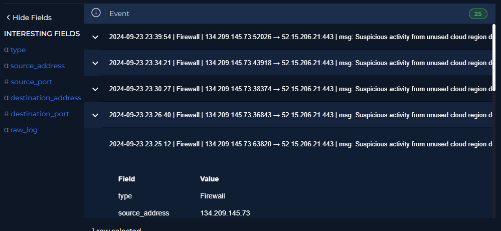
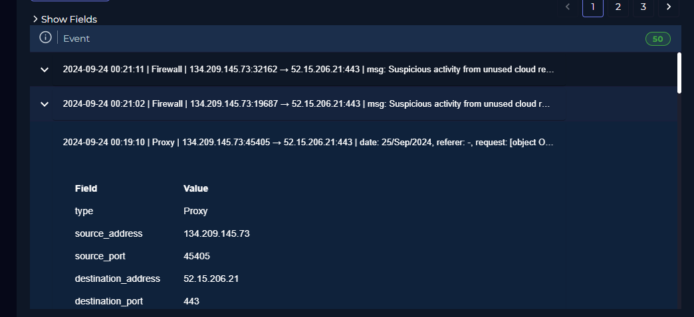
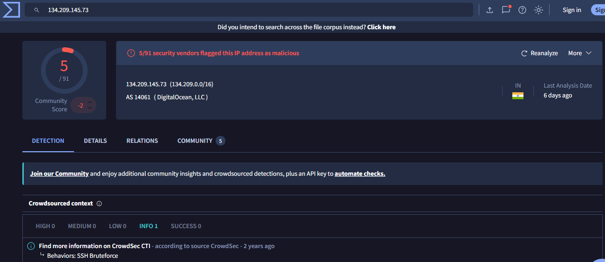
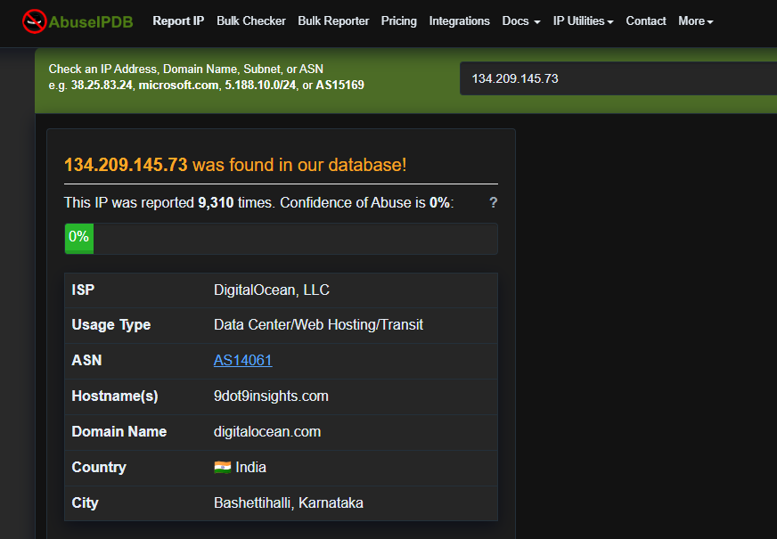

# Reporte de Análisis de Alerta
> **Plataforma:** LetsDefend
> **Nivel:** Analista L1

---

## 1. INFORMACIÓN GENERAL DE LA ALERTA

| Campo                | Detalle                                                      |
| -------------------- | ------------------------------------------------------------ |
| **ID de Alerta**     | `303`                                                        |
| **Nombre de Alerta** | *SOC325 - Unauthorized Cloud Region Access Attempt Detected* |
| **Fecha y Hora**     | `2024-09-24 08:21:15 UTC+3`                                  |
| **Severidad**        | 🟢 Low                                                       |
| **Categoría**        | *Web Attack*                                                 |
| **Analista**         | *achalmag*                                                   |
| **Estado Final**     | ✅ True Positive                                              |

---

## 2. ACTIVOS INVOLUCRADOS

### Dirección de red observada
| Origen (SRC)         | Destino (DST)      |
| -------------------- | ------------------ |
| IP: `134.209.145.73` | IP: `52.15.206.21` |
| Puerto: `50231`      | Puerto: `443`      |

---

## 3. DESCRIPCIÓN DE LA ALERTA

> La alerta se disparó por múltiples intentos de acceso por un solo usuario en el endpoint `/accounts/login` desde una región no autorizada, provenientes de la IP 134.209.145.73 en un lapso de 40 minutos.

---

## 4. INVESTIGACIÓN / ANÁLISIS

### 4.1 Análisis de la IP de origen

| Herramienta      | Resultado                                       |
| ---------------- | ----------------------------------------------- |
| **VirusTotal**   | *5/91 motores detectan la IP como sospechosa*   |
| **AbuseIPDB**    | *Confidence Score: 0% — Reportada: 9,310 veces* |
| **Whois / ASN**  | *India, DigitalOcean, LLC, AS14061*             |


> **Conclusión de la IP:** Sospechosa

---

### 4.2 Análisis del tráfico / logs

```
2024-09-24 00:21:11 | Firewall | 134.209.145.73:32162 --> 52.15.206.21:443

msg: Suspicious activity from unused cloud region detected, connection blocked
url: /accounts/login
date: 2024-09-24
user: test@letsdefend.io
action: blocked
domain: app.letsdefend.io
dst_ip: 52.15.206.21
method: POST
reason: access_denied
src_ip: 134.209.145.73
subtype: webfilter
dst_port: 443
policyid: 1
severity: critical
src_port: 50231

```


```
2024-09-24 00:19:10 | Proxy | 134.209.145.73:45405 --> 52.15.206.21:443

date: 24/sept/2024
referer: -
request: [object Object]
user_id: -
ip_address: 134.209.145.73
user_agent: Mozilla/5.0
response_code: 403
response_size: 512
client_identity: -
warning_message: Suspicious request from unused cloud region (134.209.145.73)

```

**Observaciones:**
- [x] El patrón coincide con la descripción de la alerta
- [x] Se observa múltiples intentos de acceso por el usuario test@letsdefend.io
- [x] Blockeo de respuesta (código 403 - Acceso Prohibido)

---

### 4.3 Timeline de eventos

| #   | Timestamp (UTC-5)     | Evento                                                                                                                                    |
| --- | --------------------- | ----------------------------------------------------------------------------------------------------------------------------------------- |
| 1   | `2024-09-23 23:25:12` | Primer evento registrado: Petición `POST /accounts/login` desde `134.209.145.73`. Resultado: `action: blocked` (`reason: access_denied`). |
| 5   | `2024-09-23 23:35:55` | Todas las peticiones fueron bloqueadas por el filtro web (`HTTP 403` / `action: blocked`).                                                |
| ... | ...                   | ...                                                                                                                                       |
| 50  | `2024-09-24 00:21:11` | Último evento registrado: Petición `POST /accounts/login` desde `134.209.145.73`. Resultado: `action: blocked` (`reason: access_denied`). |

---

## 5. CORRELACIÓN CON MITRE ATT&CK

| Táctica              | Técnica                          | ID      |
| -------------------- | -------------------------------- | ------- |
| Resource Development | Compromise Accounts              | `T1586` |
| Initial Access       | Valid Accounts                   | `T1078` |
| Initial Access       | External Remote Services         | `T1133` |
| Stealth              | Unused/Unsupported Cloud Regions | `T1535` |

---

## 6. VEREDICTO Y JUSTIFICACIÓN

### Clasificación: `TRUE POSITIVE`

> **Justificación detallada:**  
> La dirección IP de origen 134.209.145.73 realizó múltiples intentos de acceso hacia el endpoint /acount/login desde una región no autorizada y en un periodo de tiempo corto. La IP fue reportada 9310 veces en AbuseIPDB, ademas de ser considerado malicioso por 5 motores en VirusTotal. Todas las peticiones fueron efectivamente denegadas (HTTP 403 Forbidden) por las reglas del Proxy y el Firewall, no registrándose ningún acceso exitoso.

---

## 7. ACCIONES TOMADAS (Escalación / Contención)

- [ ] **Escalado a L2/L3** — Motivo: Acción ya bloqueada sin acceso exitoso.
- [x] **IP bloqueada** Las reglas de firewall prohíben el acceso desde regiones no autorizadas
- [x] **Evidencia preservada** (logs, capturas)
- [x] **Ticket creado** / caso abierto en plataforma

---

## 8. EVIDENCIA RECOPILADA

| #   | Tipo               | Descripción                                 | Fuente         |
| --- | ------------------ | ------------------------------------------- | -------------- |
| 1   | Logs               | Capturas de detección de intentos de acceso | Firewall/Proxy |
| 2   | Reporte VirusTotal | IP 134.209.145.73 — 5/91 detecciones        | VirusTotal     |
| 3   | Reporte AbuseIPDB  | Captura de 9310 reportes                    | AbuseIPDB      |


1. Logs de Firewall/Proxy





2. Reporte VirusTotal



3. Reporte AbuseIPDB




---

## 9. REFERENCIAS

- [MITRE ATT&CK - T1535](https://attack.mitre.org/techniques/T1535/)
- [MITRE ATT&CK - T1133](https://attack.mitre.org/techniques/T1133/)
- [MITRE ATT&CK - T1078](https://attack.mitre.org/techniques/T1078/)
- [MITRE ATT&CK - T1586](https://attack.mitre.org/techniques/T1586/)
- [VirusTotal](https://www.virustotal.com)
- [AbuseIPDB](https://www.abuseipdb.com)

---

> **Fecha de cierre del caso:** `2026-08-27`  
> **Analista:** `achalmag` — Nivel L1

---

